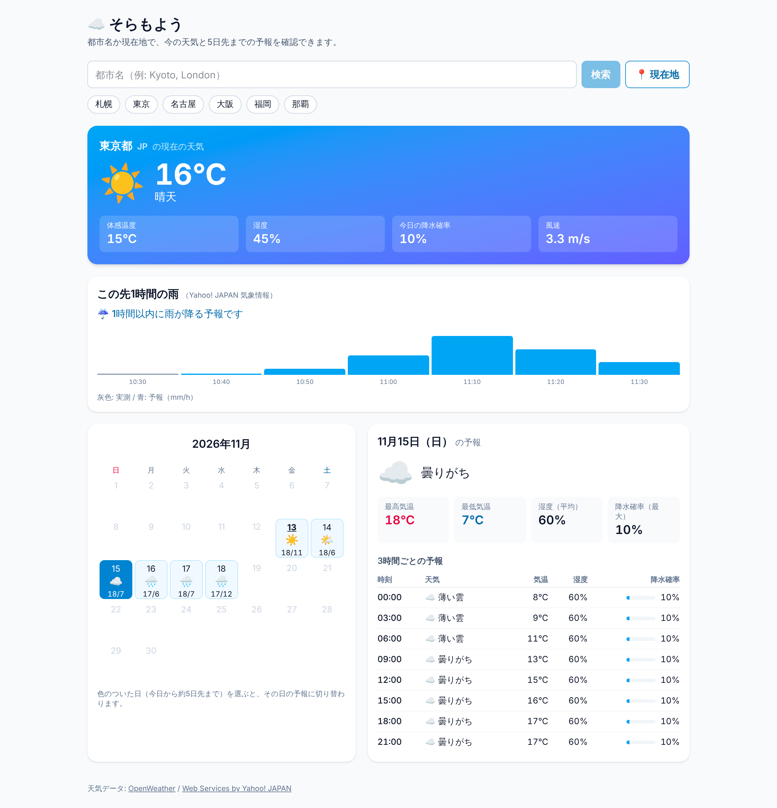
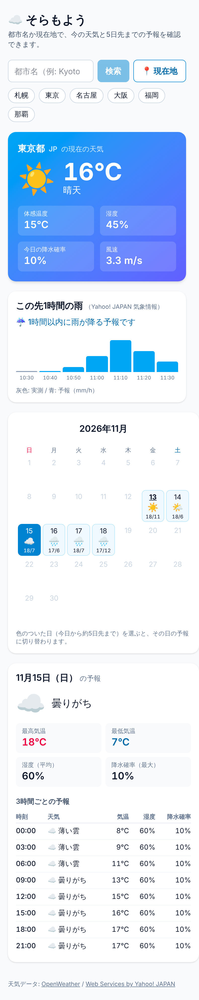

# ☁️ そらもよう — 天気予報アプリ

OpenWeatherMap（無料プラン）と連携した天気予報 Web アプリです。
都市名か現在地で、**気温・天気・湿度・降水確率**を表示し、**カレンダーで日付を選ぶと**その日の予報に切り替わります。
日本国内の地点では、**Yahoo! JAPAN の気象情報 API** で「この先 1 時間の雨」も表示できます（任意）。





## できること

| 要件 | 実装 |
| --- | --- |
| 任意の都市 or 現在地の天気 | 検索欄・よく使う都市ボタン・「📍 現在地」ボタン（ブラウザの位置情報） |
| 気温・天気・湿度・降水確率 | 現在の天気カード＋選んだ日の予報（3 時間ごとの表つき） |
| カレンダーで日付を切り替え | 月カレンダーの「色のついた日」（今日〜約 5 日先）をクリック |
| API キーは環境変数 | `.env.local` / Vercel の Environment Variables。コードには直書きしない |
| （先取り）Yahoo! 連携 | `YAHOO_CLIENT_ID` を設定すると「この先 1 時間の雨」を表示 |

## しくみ

```
ブラウザ ──(/api/weather?city=Tokyo)──▶ Next.js の Route Handler ──(APIキー付き)──▶ OpenWeatherMap
        ◀──────── 整形済み JSON ────────                    ◀──────────────────
```

- ブラウザは **自分のサーバー（`/api/weather`, `/api/rain`）だけ** を呼びます。
  API キーはサーバー側の `process.env` でしか使わないので、ブラウザの開発者ツールで見てもキーは出てきません。
  （`NEXT_PUBLIC_` を付けた環境変数はブラウザに埋め込まれてしまうため、**付けていません**。）
- OpenWeatherMap の無料 API を 3 つ使っています。
  - Geocoding API … 都市名 ⇄ 緯度経度
  - Current Weather Data … 現在の天気
  - 5 day / 3 hour Forecast … 5 日先まで 3 時間ごとの予報（降水確率 `pop` 入り）
- 3 時間ごとの予報を「その土地の日付」ごとにまとめ、最高/最低気温・平均湿度・最大降水確率・代表の天気（正午に近い時間帯）を計算しています（`src/lib/openweather.ts`）。

## ローカルで動かす

1. OpenWeatherMap に登録して API キーを取得します（無料）: https://home.openweathermap.org/api_keys
   ※ 発行直後のキーは有効になるまで **最大 2 時間ほど** かかることがあります（その間は「API キーが無効です」と表示されます）。
2. 環境変数ファイルを作ってキーを入れます。

   ```bash
   cd weather-app
   ```

   ```bash
   cp .env.example .env.local
   ```

   ```txt
   # .env.local
   OPENWEATHER_API_KEY=ここに取得したキー
   YAHOO_CLIENT_ID=          # 任意
   ```

3. 起動します。

   ```bash
   npm install
   ```

   ```bash
   npm run dev
   ```

   http://localhost:3000 を開きます。

## Yahoo!天気と API 連携できる？（先取り課題）

結論: **「Yahoo!天気」の予報データそのものを取る公式 API はありません**。サイトの HTML を読み取る（スクレイピング）のは利用規約上 NG なので使っていません。

代わりに、Yahoo! JAPAN が公開している **YOLP「気象情報 API」** と連携しました。
これは Yahoo!天気の雨雲レーダーと同じ系統のデータで、指定地点の **降水強度（mm/h）を 10 分ごとに、実測と 60 分先までの予報** で返してくれます（日本国内のみ）。

1. https://e.developer.yahoo.co.jp/register でアプリケーションを登録し、**Client ID** を取得します
   （「ID連携を利用しない」のクライアントサイドで OK）。
2. `.env.local`（本番は Vercel）に `YAHOO_CLIENT_ID=取得したClient ID` を追加します。
3. 日本国内の都市を表示すると「この先 1 時間の雨」カードが出ます。未設定のときはカードを出さないだけで、他の機能はそのまま動きます。

> 利用規約に従い、画面下にクレジット「Web Services by Yahoo! JAPAN」を表示しています。
> Yahoo! の API は提供内容が変わることがあります。動かなくなったら公式ドキュメントで最新の仕様を確認してください:
> https://developer.yahoo.co.jp/webapi/map/openlocalplatform/v1/weather.html

## GitHub に新しいリポジトリを作る

このフォルダは、Todo アプリ（aimu-focus）のリポジトリの中で作りました。課題どおり **独立したリポジトリ** にするには:

1. GitHub で空のリポジトリ（例: `weather-app`）を作成します（README などは追加しない）。
2. このフォルダの中身だけを新しいリポジトリとして push します。

   ```bash
   cp -r weather-app ~/weather-app && cd ~/weather-app && rm -rf node_modules .next
   ```

   ```bash
   git init && git add . && git commit -m "feat: 天気予報アプリ"
   ```

   ```bash
   git branch -M main && git remote add origin https://github.com/<あなたのユーザー名>/weather-app.git && git push -u origin main
   ```

   `.env.local` は `.gitignore` で除外されているので、キーが GitHub に上がることはありません（`git status` で念のため確認）。

## Vercel にデプロイする

1. https://vercel.com/new で上の GitHub リポジトリを Import します。
   - aimu-focus リポジトリのままデプロイする場合は **Root Directory** に `weather-app` を指定します。
2. **Environment Variables** に以下を追加します（Production / Preview / Development すべてにチェック）。

   | Key | Value |
   | --- | --- |
   | `OPENWEATHER_API_KEY` | OpenWeatherMap の API キー |
   | `YAHOO_CLIENT_ID` | （任意）Yahoo! の Client ID |

3. Deploy を押します。あとから環境変数を変えたときは **Redeploy** が必要です。

## 開発用コマンド

```bash
npm test          # 自動テスト（Vitest）
```

```bash
npm run lint      # ESLint
```

```bash
npm run build     # 本番ビルド（型チェック込み）
```

テストは外部 API を呼ばず、偽の応答（`src/test/fixtures.ts`）で動かしています。
日付のまとめ方・API キーがレスポンスに漏れないこと・カレンダーで日付を切り替えられること などを確認しています。

## ファイル構成

```
src/
  app/
    page.tsx                 … トップページ
    api/weather/route.ts     … OpenWeatherMap を呼ぶサーバー側の窓口
    api/rain/route.ts        … Yahoo! 気象情報 API を呼ぶ窓口（任意）
  components/
    WeatherApp.tsx           … 画面全体（状態管理）
    SearchBar.tsx            … 検索・現在地
    CurrentWeatherCard.tsx   … 現在の天気
    ForecastCalendar.tsx     … 日付を選ぶカレンダー
    DayDetail.tsx            … 選んだ日の予報
    RainNowcast.tsx          … この先 1 時間の雨
  lib/
    openweather.ts           … OpenWeatherMap の呼び出しとデータ整形
    yahoo.ts                 … Yahoo! 気象情報 API の呼び出し
    calendar.ts / date.ts    … カレンダー・日付の計算
```
